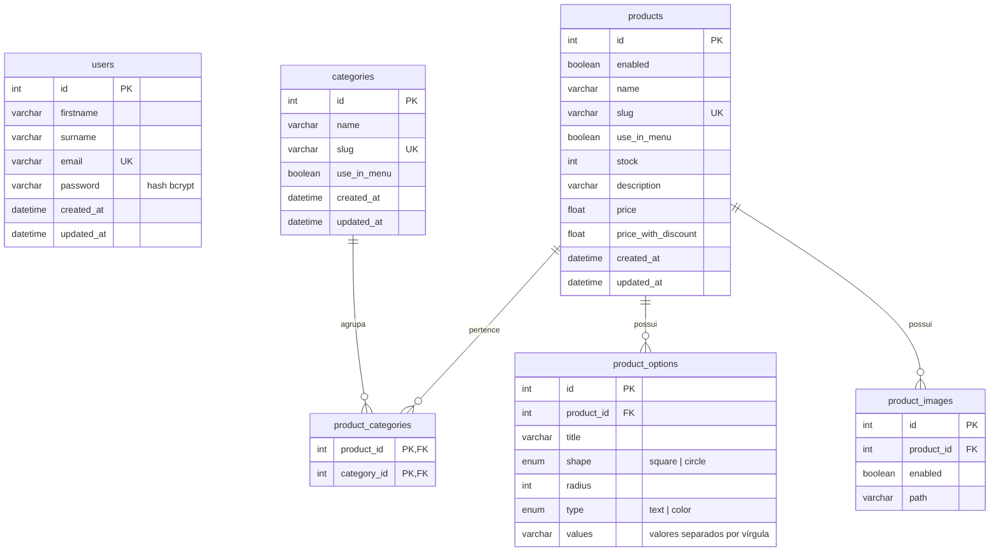

# Digital Store API

API REST da **Digital Store**, desenvolvida como parte do curso da Digital College (Curso de Full Stack da Geração Tech - IEL), seguindo os requisitos de [projeto-backend](https://github.com/digitalcollegebr/projeto-backend). Ela gerencia **usuários**, **categorias** e **produtos** (com imagens e opções) e usa autenticação via **JWT**.

## Tecnologias

| Tecnologia | Uso |
| --- | --- |
| Node.js + Express 5 | Servidor HTTP e rotas da API |
| MySQL 8 + Sequelize | Banco de dados, ORM, migrations e seeders |
| JSON Web Token + bcrypt | Autenticação e hash de senhas |
| Swagger UI (OpenAPI 3) | Documentação interativa |
| Dotenv / Nodemon | Configuração por ambiente / recarga automática em desenvolvimento |
| Jest + Supertest | Testes automatizados |

## Como rodar o projeto

### Pré-requisitos

- [Node.js](https://nodejs.org/) 18 ou superior
- MySQL 8, **ou** [Docker](https://www.docker.com/) para subir o banco pelo `docker-compose.yml` do projeto

### Passo a passo

```bash
# 1. Clone o repositório e instale as dependências
git clone https://github.com/alexsanderk2/projeto-backend.git
cd projeto-backend
npm install

# 2. Crie o arquivo .env a partir do exemplo (ajuste os valores se necessário)
cp .env.example .env

# 3. Suba o MySQL com Docker (porta 3308)
docker compose up -d
#    Usando um MySQL próprio? Ajuste DB_HOST/DB_PORT/DB_USER/DB_PASSWORD no .env
#    e crie o banco com: npm run db:create

# 4. Crie as tabelas e popule com dados de exemplo
npm run db:migrate
npm run db:seed

# 5. Inicie a API
npm run dev     # desenvolvimento (nodemon)
# ou
npm start       # produção
```

A API fica disponível em `http://localhost:3333` e a documentação em **`http://localhost:3333/docs`**.

> O seeder cria o usuário `admin@digitalstore.com` com a senha `123@123`, além de categorias e produtos de exemplo.

### Variáveis de ambiente

| Variável | Descrição | Padrão |
| --- | --- | --- |
| `PORT` | Porta do servidor | `3333` |
| `APP_URL` | URL base usada para montar o link das imagens | `http://localhost:3333` |
| `DB_HOST` / `DB_PORT` | Endereço do MySQL | `localhost` / `3308` |
| `DB_USER` / `DB_PASSWORD` | Credenciais do MySQL | `root` / `root` |
| `DB_NAME` | Nome do banco | `digital_store` |
| `JWT_SECRET` | Chave usada para assinar os tokens | — |
| `JWT_EXPIRES_IN` | Validade do token | `1d` |

### Scripts

| Comando | Descrição |
| --- | --- |
| `npm run dev` | Inicia a API com recarga automática |
| `npm start` | Inicia a API |
| `npm run db:create` | Cria o banco de dados |
| `npm run db:migrate` | Executa as migrations |
| `npm run db:migrate:undo` | Desfaz todas as migrations |
| `npm run db:seed` | Popula o banco com dados de exemplo |
| `npm run db:reset` | Recria as tabelas e os dados de exemplo |
| `npm test` | Executa os testes |

## Endpoints

🔒 = exige o cabeçalho `Authorization: Bearer <token>`.

### Usuários e autenticação

| Método | Rota | Descrição | Sucesso |
| --- | --- | --- | --- |
| `POST` | `/v1/user/token` | Gera o token JWT | `200` |
| `GET` | `/v1/user/:id` | Busca um usuário | `200` |
| `POST` | `/v1/user` | Cadastra um usuário | `201` |
| `PUT` | `/v1/user/:id` 🔒 | Atualiza o próprio usuário | `204` |
| `DELETE` | `/v1/user/:id` 🔒 | Remove o próprio usuário | `204` |

### Categorias

| Método | Rota | Descrição | Sucesso |
| --- | --- | --- | --- |
| `GET` | `/v1/category/search` | Lista categorias (`limit` de 1 a 100 ou `-1`, `page`, `fields`, `use_in_menu`) | `200` |
| `GET` | `/v1/category/:id` | Busca uma categoria | `200` |
| `POST` | `/v1/category` 🔒 | Cadastra uma categoria | `201` |
| `PUT` | `/v1/category/:id` 🔒 | Atualiza uma categoria | `204` |
| `DELETE` | `/v1/category/:id` 🔒 | Remove uma categoria | `204` |

### Produtos

| Método | Rota | Descrição | Sucesso |
| --- | --- | --- | --- |
| `GET` | `/v1/product/search` | Lista produtos com filtros | `200` |
| `GET` | `/v1/product/:id` | Busca um produto | `200` |
| `POST` | `/v1/product` 🔒 | Cadastra um produto com imagens e opções | `201` |
| `PUT` | `/v1/product/:id` 🔒 | Atualiza um produto, imagens e opções | `204` |
| `DELETE` | `/v1/product/:id` 🔒 | Remove um produto | `204` |

**Filtros de `GET /v1/product/search`:**

| Parâmetro | Exemplo | Descrição |
| --- | --- | --- |
| `limit` | `limit=30` | Itens por página, de 1 a 100 (`-1` = todos). Padrão `12` |
| `page` | `page=2` | Página. Padrão `1` |
| `fields` | `fields=name,images,price` | Campos retornados |
| `match` | `match=Tênis` | Termo no nome ou na descrição |
| `category_ids` | `category_ids=15,24` | Produtos de qualquer uma das categorias |
| `price-range` | `price-range=100-200` | Faixa de preço |
| `option[id]` | `option[45]=GG,PP` | Produtos cuja opção possui algum dos valores (também aceita o título: `option[Tamanho]=P`) |

### Códigos de resposta

| Código | Quando |
| --- | --- |
| `200 OK` | Consulta ou geração de token bem-sucedida |
| `201 Created` | Recurso criado (retorna o recurso) |
| `204 No Content` | Atualização ou remoção bem-sucedida (sem corpo) |
| `400 Bad Request` | Dados inválidos, slug/e-mail duplicado ou credenciais incorretas |
| `401 Unauthorized` | Token ausente, malformado, inválido ou expirado |
| `403 Forbidden` | Tentativa de alterar/remover a conta de outro usuário |
| `404 Not Found` | Recurso ou rota inexistente |

Os erros seguem sempre o formato:

```json
{
  "message": "Dados inválidos",
  "details": [{ "field": "email", "message": "email inválido" }]
}
```

### Exemplo rápido com cURL

```bash
# Gera o token
TOKEN=$(curl -s -X POST http://localhost:3333/v1/user/token \
  -H "Content-Type: application/json" \
  -d '{"email":"admin@digitalstore.com","password":"123@123"}' | node -pe 'JSON.parse(require("fs").readFileSync(0)).token')

# Cria uma categoria
curl -X POST http://localhost:3333/v1/category \
  -H "Content-Type: application/json" -H "Authorization: Bearer $TOKEN" \
  -d '{"name":"Acessórios","slug":"acessorios","use_in_menu":true}'

# Busca produtos de uma categoria até R$ 250
curl "http://localhost:3333/v1/product/search?category_ids=1&price-range=0-250&fields=id,name,price"
```

## Banco de dados



**Decisões de modelagem**

- Toda a estrutura é criada por **migrations** (`src/database/migrations`), versionadas junto com o código.
- `email` (users) e `slug` (categories/products) são **únicos**, o que impede duplicidade e cria índices para as buscas.
- As chaves estrangeiras usam **`ON DELETE CASCADE`**: ao remover um produto, suas imagens, opções e vínculos com categorias são removidos automaticamente.
- `product_categories` usa **chave primária composta** `(product_id, category_id)`, que impede vínculos repetidos, e tem um índice extra em `category_id` para o filtro por categoria.
- Há índices em `products.price` (filtro `price-range`), `product_options(title, product_id)` (filtro `option[Título]`) e `categories.use_in_menu`.
- `price` segue o tipo `FLOAT` pedido no enunciado. Como o FLOAT tem precisão simples (59.9 é gravado como 59.900001…), o filtro `price-range` aplica uma tolerância de meio centavo nas bordas e as respostas arredondam para 2 casas.

**Consultas eficientes**

- A busca de produtos executa uma consulta paginada para os produtos e **no máximo uma consulta por relação** (categorias, imagens e opções) para todos os itens da página, evitando o problema de N+1.
- As relações só são carregadas quando o campo é solicitado em `fields`.
- Os filtros por categoria e por opção usam subconsultas (`id IN (SELECT ...)`) sobre colunas indexadas, sem duplicar linhas.
- Criação e atualização de produtos rodam em **transação**, com as linhas de imagens e opções bloqueadas (`SELECT ... FOR UPDATE`) durante a atualização. Se algo falhar, nada é salvo no banco e as imagens já gravadas no disco são descartadas.

## Estrutura de pastas

```
projeto-backend/
├── public/media/            # Imagens enviadas (servidas em /media)
├── src/
│   ├── config/              # Variáveis de ambiente, banco e Swagger
│   ├── controllers/         # Recebem a requisição e devolvem a resposta HTTP
│   ├── database/
│   │   ├── migrations/      # Criação das tabelas
│   │   └── seeders/         # Dados de exemplo
│   ├── docs/openapi.yaml    # Especificação da API
│   ├── middleware/          # Autenticação JWT e tratamento de erros
│   ├── models/              # Models e associações do Sequelize
│   ├── routes/              # Definição das rotas
│   ├── services/            # Regras de negócio e acesso ao banco
│   ├── utils/               # Erros e helpers de validação/query
│   ├── validators/          # Validação e normalização dos payloads
│   ├── app.js               # Configuração do Express
│   └── server.js            # Inicialização do servidor
├── tests/
├── .env.example
├── docker-compose.yml
└── package.json
```

O fluxo de uma requisição é: **rota → middleware (auth) → controller → validator → service → model**. Qualquer erro lançado é convertido em resposta HTTP pelo middleware central de erros.

## Observações sobre o enunciado

- **Cadastro e token são públicos.** O enunciado pede token em todos os `POST`, mas `POST /v1/user` e `POST /v1/user/token` precisam funcionar sem token, senão não seria possível criar a primeira conta nem fazer login.
- **Token ausente ou inválido retorna `401`.** A seção 05 do enunciado cita `400`, mas cada endpoint lista `401 Unauthorized` para esse caso; seguimos o padrão HTTP (`401`).
- **Autorização de usuários:** um usuário autenticado só pode alterar ou remover a própria conta (`403` caso contrário).
- **Opções do produto:** o payload aceita tanto `values` quanto `value` (o enunciado usa os dois) e `radius` como número ou `"4px"`.
- **Filtro `option[...]`:** uma chave numérica é tratada como ID da opção. Como cada opção pertence a um único produto, `option[45]` casa no máximo um produto; por isso também é aceito o título (`option[Tamanho]=P,M`), que filtra entre todos os produtos.
- **Imagens:** são aceitas PNG, JPG, GIF e WEBP de até 5 MB. O conteúdo é conferido pelos primeiros bytes do arquivo e precisa corresponder ao `type` informado.
- **Produtos desabilitados** (`enabled: false`) também aparecem na busca, já que o enunciado não define filtro para eles; o campo vem na resposta para o front-end decidir o que exibir.

## Segurança

- Senhas armazenadas com hash **bcrypt** (no máximo 72 bytes, limite do algoritmo) e nunca retornadas pela API.
- Tokens JWT assinados com HS256. Tokens de usuários excluídos são rejeitados, e em produção a API não sobe sem um `JWT_SECRET` forte (32+ caracteres).
- O login sempre executa a comparação bcrypt e usa a mesma mensagem de erro, dificultando descobrir quais e-mails estão cadastrados.
- Todos os dados de entrada são validados (tipos, tamanho máximo dos textos e limites numéricos), e erros de banco são convertidos em respostas HTTP padronizadas.

## Autor

Desenvolvido por [@alexsanderk2](https://github.com/alexsanderk2).
